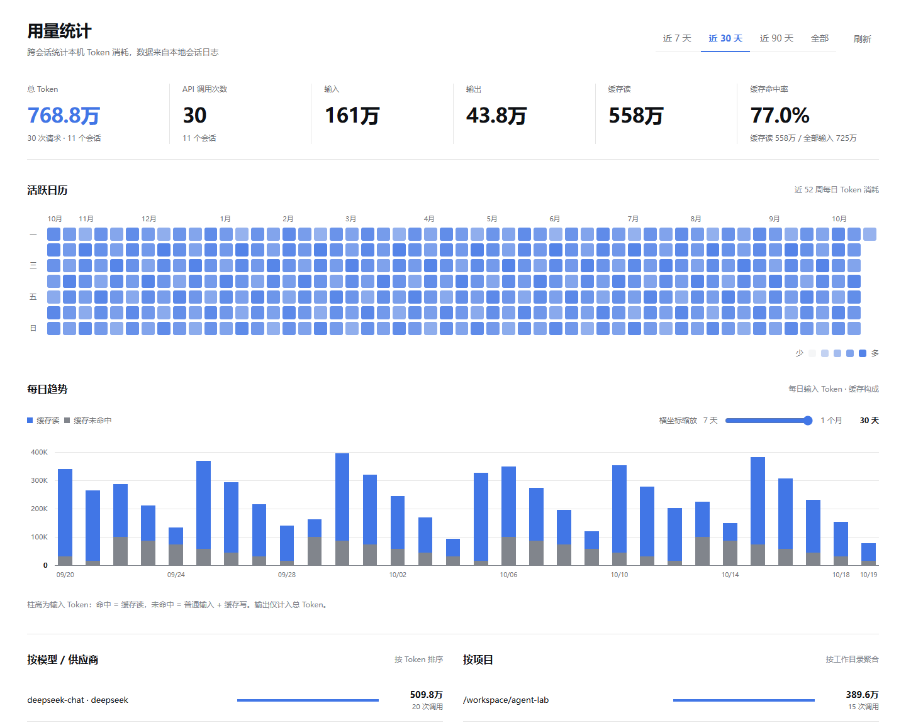

<div align="center">

# DSH Token Monitor

**在一个面板中查看本地 Token 消耗、API 调用和缓存使用情况。**

为 DeepSeek Harness 提供轻量的用量统计。无需构建、无运行时依赖、不需要额外的 API Key。

[English](README.md) · [简体中文](README.zh-CN.md)

[](LICENSE)


[功能](#功能) · [快速开始](#快速开始) · [统计口径](#统计口径)

</div>

<picture>
  <source media="(prefers-color-scheme: dark)" srcset="docs/images/overview-dark.png">
  
</picture>

_预览使用示例数据，插件界面会跟随 DSH 的主题。_

## 为什么使用它？

跨会话查看 Token 消耗，了解哪些项目用量最多，以及输入有多少命中缓存。插件直接读取当前 DSH profile 可见的会话日志，在原生侧栏中展示统计结果。

## 功能

| 功能           | 说明                                                              |
| -------------- | ----------------------------------------------------------------- |
| 用量总览       | 总 Token、API 调用次数、普通输入、输出、缓存读取和缓存命中率      |
| 时间筛选       | 近 7 / 30 / 90 天或全部时间，同时显示活跃会话数                   |
| 活跃日历       | 52 周圆角正方形网格，悬停或聚焦查看当天精确数据                   |
| 每日缓存趋势   | 输入 Token 堆叠柱图，未命中位于底部，命中位于上方，零轴有明确基线 |
| 图表缩放       | 独立切换近 7–30 天，纵轴使用 K/M/B 简写                           |
| 模型与项目排行 | 按模型/供应商、工作目录汇总 Token 和 API 调用次数                 |
| 原生界面       | 深浅主题、自适应布局、中英文界面                                  |
| 刷新控制       | 手动刷新或每 30 秒自动刷新，页面隐藏时暂停轮询                    |

## 快速开始

### 1. 获取插件

通过 GitHub 的 **Code → Download ZIP** 下载并解压。包含 `package.json` 的目录就是插件目录；如果本项目位于更大的仓库中，请选择其中的 `token-monitor` 子目录。

### 2. 安装到 DSH

在 DSH 插件管理器中安装本地插件目录，也可以使用安装环境提供的 DSH CLI：

```sh
# Web profile：请替换为插件的绝对路径。
dsh plugin --profile web add /absolute/path/to/token-monitor
```

Desktop 请使用桌面应用附带的 CLI：

```sh
dsh plugin --profile desktop add /absolute/path/to/token-monitor
```

Windows 路径也可以写为 `C:/plugins/token-monitor`，包含空格时请加引号。如果 `dsh` 不在 PATH 中，请使用实际安装的可执行文件或命令文件调用。源码 CLI 可能拒绝 Desktop profile；管理该 profile 时请使用桌面应用附带的 CLI。

### 3. 打开面板

重启 DSH，在侧栏选择 **用量统计**。已有的已结算请求会自动纳入统计，不需要为统计额外发起模型请求。

> **兼容性：** 需要 DSH 提供 `sessionPersistence`、`connection`、slot、locale 和主题 API。DSH 插件 API 可能随版本变化，请确认与你使用的版本兼容。

## 使用方式

- 使用顶部时间选项切换汇总范围，指标和排行榜随之更新。
- 悬停或使用键盘聚焦日历方格、每日柱形，查看精确用量与 API 调用次数；按 **Escape** 关闭浮层。
- 拖动趋势图滑块，在近 **7–30 天**之间缩放；「1 个月」按滚动 30 天计算。
- 日历与趋势图独立于汇总范围，切换顶部时间选项会保留趋势缩放。
- 在页面底部开启或关闭自动刷新。

## 统计口径

| 指标         | 计算方式                                                                                       |
| ------------ | ---------------------------------------------------------------------------------------------- |
| 总 Token     | 优先使用供应商的 `totalTokens`，未提供时累加普通输入、输出、缓存读与缓存写                     |
| 输入         | 仅普通输入，不含缓存读取和写入                                                                 |
| 输出         | 供应商报告的输出，不重复累加推理 Token                                                         |
| 缓存命中率   | 缓存读 ÷（普通输入 + 缓存读 + 缓存写），分母为零时显示 `—`                                     |
| API 调用次数 | 已结算的 `assistant/message`、`assistant/attempt` 记录，包含已结算的失败尝试和未报告用量的请求 |
| 每日柱形     | 仅输入：未命中 = 普通输入 + 缓存写，命中 = 缓存读                                              |
| 会话数       | 所选汇总范围内至少有一次已结算请求的会话数                                                     |

流式请求在结算后显示。未报告用量的请求会增加 API 调用次数，但不会估算 Token。同一次尝试的重复结算会去重；重试单独计数，分叉会话继承的记录不重复统计。

自然日按浏览器的 IANA 时区划分，日历每周从周一开始。输出计入总 Token 和浮层详情，不参与输入缓存柱图的堆叠。

## 数据与隐私

插件通过只读句柄读取本地会话日志，不修改日志、不调用模型 API、不上传用量数据。面板所需的数字汇总、模型名称、会话 ID 和工作目录暂存在内存中，缓存不保留提示词或回答内容。

每个发生变更的会话都会先完整读取，再按持久化版本号缓存数字汇总。首次加载或刷新超大日志时可能较慢；读取失败的会话会触发可见的统计不完整提示。

本项目统计 Token 用量，不计算账单金额或网络带宽；供应商的计费口径可能与日志统计不同。


## 项目结构

```text
token-monitor/
├── client.js          # 面板、图表交互、样式与界面词典
├── index.js           # 只读接口与会话汇总缓存
├── usage.js           # 请求去重与 Token 聚合
├── cordis.patch.yml   # DSH bundle 注册
├── icon.svg           # 侧栏/插件图标
├── locale/            # 插件元数据翻译
├── docs/images/       # README 深浅主题预览
├── README.md
├── README.zh-CN.md
├── LICENSE
└── package.json
```

客户端保留为单个 DSH 模块，无需打包器即可安装。React 和 DSH 服务由宿主提供。

## 开发与打包

无需安装依赖，也无需编译。检查 JavaScript 语法：

```sh
npm run check
```

生成可安装压缩包：

```sh
npm pack --ignore-scripts
```

`package.json` 明确列出了分发文件，生成的安装包和本地产物由 Git 忽略。修改后请按需重新安装或加载插件，并在自己的 DSH profile 中验证。

## 参与贡献

欢迎通过 Issue 或 Pull Request 反馈问题和提交改进。报告问题时请附上 DSH 版本、profile 类型、复现步骤、预期和实际表现；分享日志或截图前请移除提示词、凭据、会话内容及私人路径。

## 许可证

[MIT](LICENSE)。本项目为社区插件，并非 DeepSeek 官方产品。
